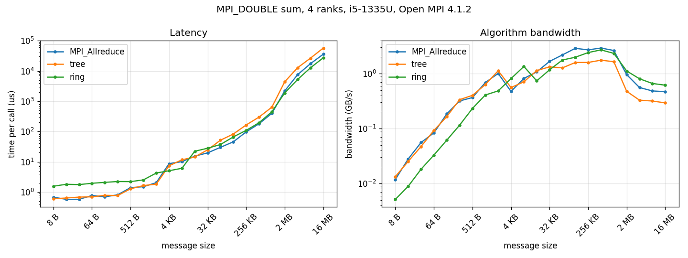

# mpi-allreduce

Two implementations of `MPI_Allreduce` (sum of `float`/`double` arrays) built from point-to-point calls, compared with the native `MPI_Allreduce`. Written in C11 with CMake/CTest, plus a Dockerfile, an Ansible playbook and Jenkins/GitHub Actions pipelines.

## Algorithms

Notation: p ranks, n bytes, α latency per message, β time per byte sent, γ time per byte added.

*   **Tree (`src/allreduce_tree.c`):** recursive doubling. At step k, rank r exchanges its whole partial sum with rank `r ^ 2^k` (`MPI_Sendrecv`) and adds it to its own, so the algorithm takes log2(p) steps. When p is not a power of two, the extra ranks first fold their data into a neighbour and get the result back at the end. Cost: log2(p)·(α + nβ + nγ).
*   **Ring (`src/allreduce_ring.c`):** reduce-scatter followed by allgather around a ring (`MPI_Isend`/`MPI_Irecv`). The array is cut into p chunks. In p-1 steps each rank accumulates the full sum of one chunk, then in p-1 more steps the reduced chunks are passed around. During the reduce-scatter, chunks travel in 64 KB segments through two receive buffers, so adding one segment overlaps receiving the next. Cost: 2(p-1)·α + 2(p-1)/p·nβ + (p-1)/p·nγ.

For p = 4 the costs are:

*   tree: 2α + 2nβ + 2nγ
*   ring: 6α + 1.5nβ + 0.75nγ

The ring pays three times as many message latencies, but each rank sends 25 % less data and does 2.7× fewer additions. It should lose on small messages and win on large ones.

Both functions accept `MPI_IN_PLACE`. Every rank ends with a bit-identical result: in the tree both partners add the same two values (IEEE addition is commutative), and in the ring each chunk is summed by one rank and then copied.

## Tests

`tests/test_correctness.c` runs the tree, the ring, and the ring with 24-byte segments (to stress the pipeline). It covers `float` and `double`, with and without `MPI_IN_PLACE`, on 19 array lengths from 0 to 2^20 + 3. The lengths include arrays with fewer elements than ranks, lengths that are not multiples of p, and large arrays. For each case it checks that:
*   the result matches a sequential sum of every rank's input, and the native `MPI_Allreduce`, within 1e-12 for `double` (1e-4 for `float`);
*   all ranks hold bit-identical results;
*   the send buffer is left unchanged.

CTest runs it with 1, 2, 3, 4, 5 and 8 ranks, plus a short benchmark run. `tests/run_tests.sh` runs it with `mpirun -np 4` (set `NPROCS="2 3 4 5"` for other counts) and adds `--oversubscribe` when it detects Open MPI.

## Performance

`build/bench` times each version on `MPI_DOUBLE` sums from 8 B to 16 MB. For each size it makes some warmup calls, then times N calls between two `MPI_Barrier`. The time per call is the maximum over ranks, and the best of 3 repetitions is kept. The largest difference from the native result was 8.9e-16.

Intel Core i5-1335U, WSL2 Ubuntu 22.04, GCC 11.4 `-O3`, Open MPI 4.1.2, `mpirun -np 4` (one node, shared memory). Times per call in µs:

| Size   | MPI_Allreduce | Tree    | Ring    | Tree / Ring |
|--------|--------------:|--------:|--------:|------------:|
| 8 B    | 0.67          | 0.60    | 1.55    | 0.39        |
| 16 B   | 0.57          | 0.63    | 1.80    | 0.35        |
| 32 B   | 0.57          | 0.68    | 1.76    | 0.39        |
| 64 B   | 0.77          | 0.69    | 1.94    | 0.36        |
| 128 B  | 0.69          | 0.78    | 2.08    | 0.37        |
| 256 B  | 0.81          | 0.76    | 2.22    | 0.34        |
| 512 B  | 1.40          | 1.27    | 2.20    | 0.58        |
| 1 KB   | 1.49          | 1.63    | 2.51    | 0.65        |
| 2 KB   | 2.04          | 1.82    | 4.23    | 0.43        |
| 4 KB   | 8.64          | 7.34    | 5.05    | 1.45        |
| 8 KB   | 10.0          | 11.6    | 6.08    | 1.90        |
| 16 KB  | 15.3          | 14.4    | 22.2    | 0.65        |
| 32 KB  | 19.7          | 24.7    | 28.0    | 0.88        |
| 64 KB  | 30.0          | 51.6    | 37.1    | 1.39        |
| 128 KB | 45.5          | 82.4    | 66.1    | 1.25        |
| 256 KB | 97.0          | 164     | 109     | 1.51        |
| 512 KB | 180           | 299     | 194     | 1.54        |
| 1 MB   | 398           | 637     | 449     | 1.42        |
| 2 MB   | 2191          | 4404    | 1878    | 2.35        |
| 4 MB   | 7523          | 12770   | 5212    | 2.45        |
| 8 MB   | 17346         | 26465   | 12681   | 2.09        |
| 16 MB  | 35784         | 57221   | 27256   | 2.10        |

Raw data: `results/bench_np4.csv`. A second run gave the same crossovers, with individual timings within about 20 %.



### Where the ring beats the tree

*   **Up to 2 KB, the tree is 1.5 to 3× faster.** The cost is almost only latency, about 0.3 µs per message on this machine. The tree sends 2 messages per rank and the ring sends 6.
*   **At 4 KB and 8 KB, the ring wins because of a protocol threshold.** Open MPI's shared-memory transport sends messages up to 4 KB (`btl_vader_eager_limit`, header included) directly and larger ones after a rendezvous handshake. The tree sends the whole array and crosses the limit at 4 KB. The ring sends chunks of n/4 (1 to 2 KB) and stays below it.
*   **At 16 KB and 32 KB, the tree wins again.** The ring's chunks now pass 4 KB too, so it pays 6 handshakes against 2.
*   **From 64 KB to 1 MB, the ring is 1.25 to 1.55× faster.** Here time depends on how many bytes are copied and added, and the ring handles fewer of them.
*   **From 2 MB, the ring is 2.1 to 2.5× faster.** The buffers of the 4 ranks (send, receive, scratch) no longer fit in the 12 MB L3 cache, so every version becomes limited by memory bandwidth, and the tree moves the most memory. In this range the ring is also 1.2 to 1.4× faster than the native `MPI_Allreduce`.

The crossover on this machine is therefore around 64 KB. The win at 4 to 8 KB comes from the eager limit, not from the algorithm. Over a network α is much larger, so the crossover moves to larger messages. The ring's latency term also grows linearly with p, while the tree's grows with log2(p).

## Prerequisites
*   CMake (>= 3.12; `ctest --test-dir` needs 3.20)
*   C11 compiler and an MPI implementation (tested with Open MPI 4.1 and 5.0)
*   Python 3 with `matplotlib` for the plot

## Quick Start
1.  **Clone the repository:**
    ```bash
    git clone https://github.com/ayoubbsn/mpi-allreduce.git
    cd mpi-allreduce
    ```
2.  **Build and run the tests:**
    ```bash
    cmake -B build -DCMAKE_BUILD_TYPE=Release
    cmake --build build
    ctest --test-dir build --output-on-failure
    ```
3.  **Run the benchmark and plot it:**
    ```bash
    mpirun -np 4 build/bench -o results/bench_np4.csv
    python3 scripts/plot_bench.py results/bench_np4.csv
    ```

`bench` options: `-n` / `-m` minimum and maximum size in bytes (`K` and `M` suffixes accepted), `-r` number of repetitions, `-o` output file (default: stdout).

## Docker

```bash
docker build -t mpi-allreduce .
docker run --rm mpi-allreduce                                         # ctest
docker run --rm mpi-allreduce mpirun -np 4 --oversubscribe build/bench -m 1M
```

## Ansible

`ansible/playbook.yml` installs the build and MPI packages with apt, clones the repository, builds it, runs ctest, runs the benchmark and copies the CSV and plot back to `ansible/results/<host>/`.

```bash
ansible-playbook -i ansible/inventory.ini ansible/playbook.yml -K
```

Use `--skip-tags deps` if the packages are already installed (no sudo needed), and `-e bench_nprocs=8 -e bench_max_bytes=4M` to change the benchmark.

## CI
*   `.github/workflows/ci.yml`: builds on Ubuntu, runs ctest, `run_tests.sh` and a short benchmark, then builds the Docker image and runs ctest inside it.
*   `Jenkinsfile`: the same steps inside the image built from the `Dockerfile`; archives the CTest JUnit report and the benchmark CSV and plot.

## Project Structure
*   `include/`: public header (`allreduce.h`).
*   `src/`: tree and ring implementations, shared helpers, benchmark.
*   `tests/`: correctness test and `run_tests.sh`.
*   `scripts/`: plotting script.
*   `results/`: benchmark data and plot from the test machine.
*   `ansible/`: playbook and example inventory.
